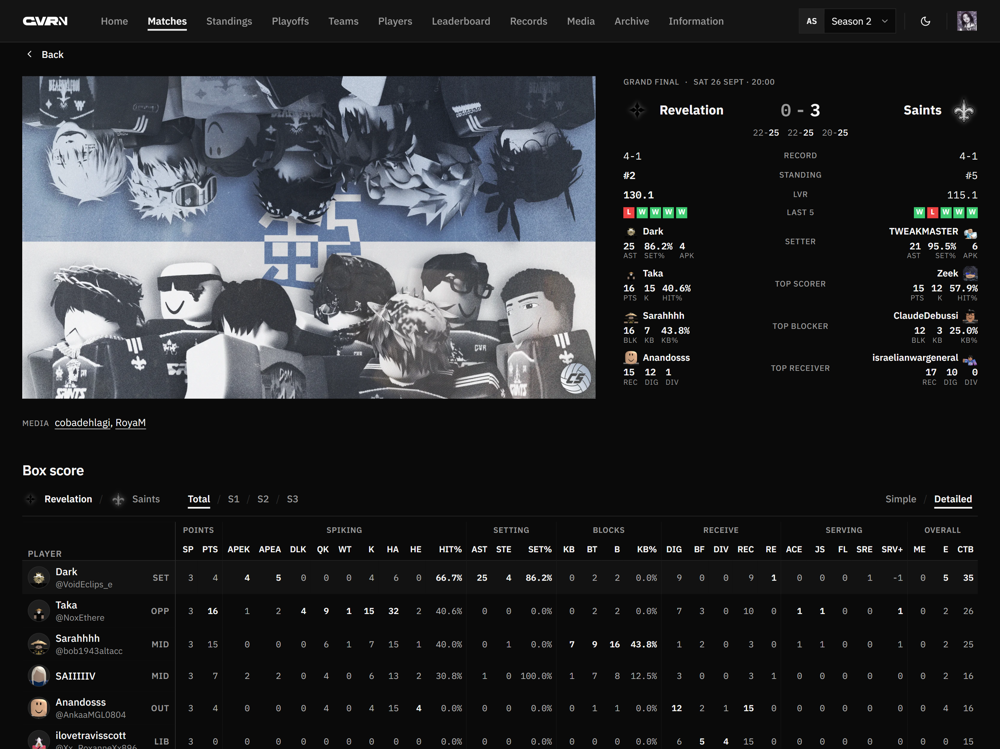
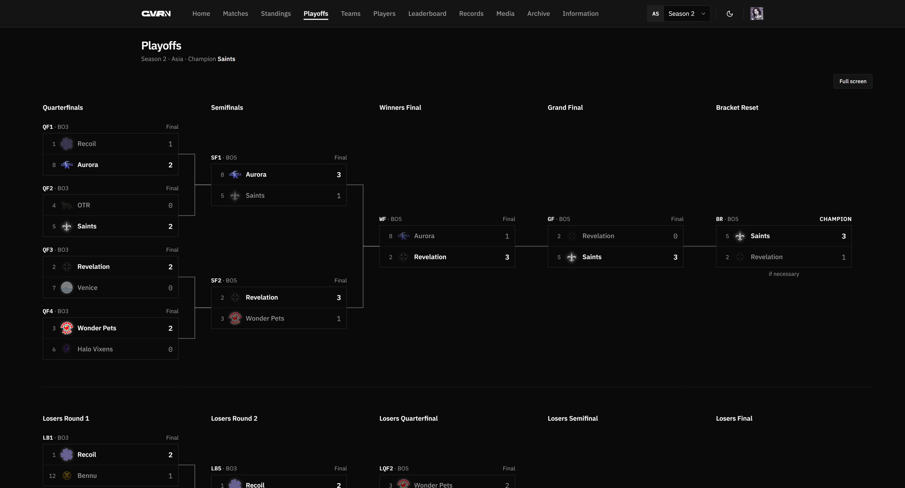
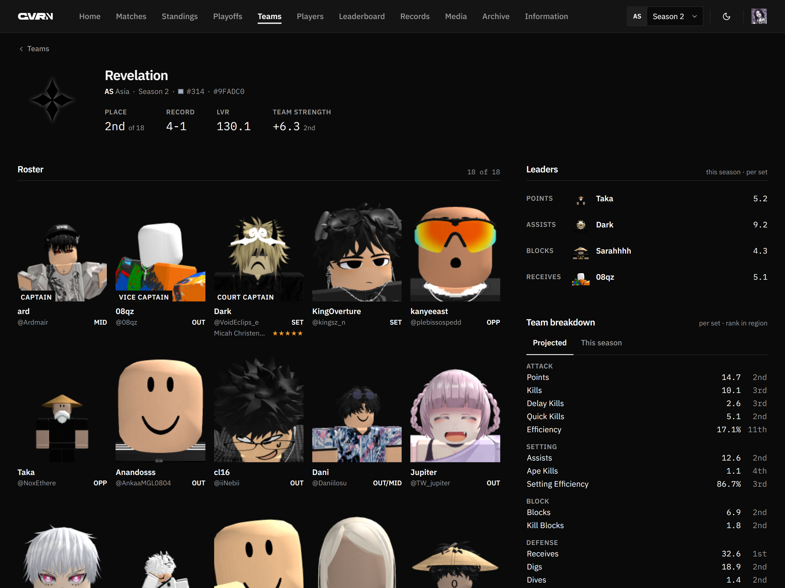
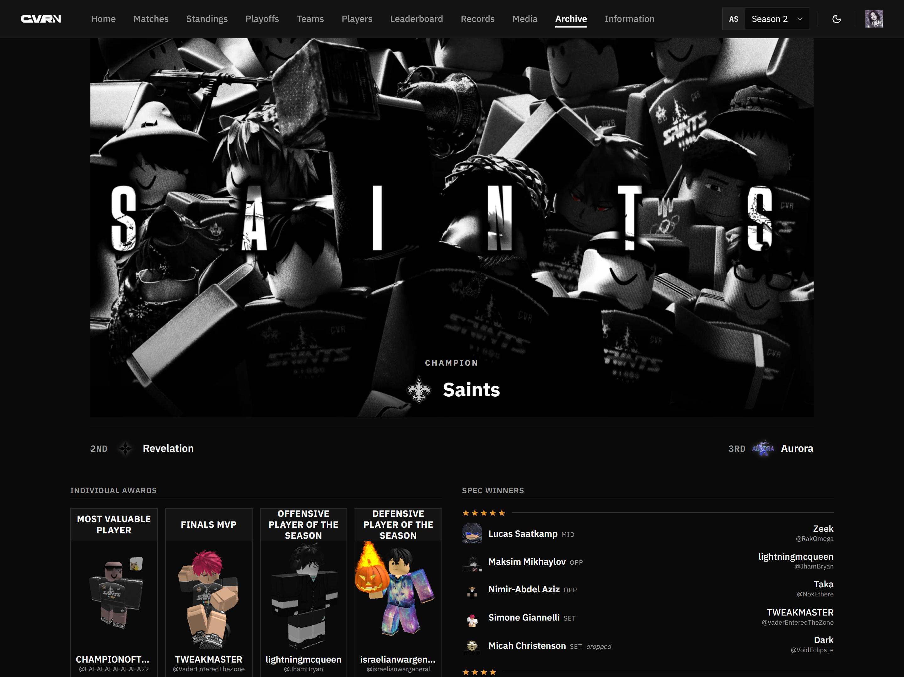
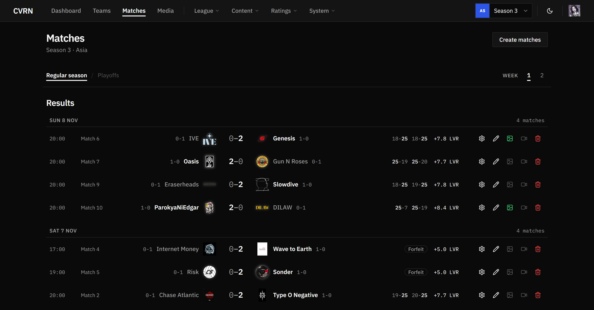
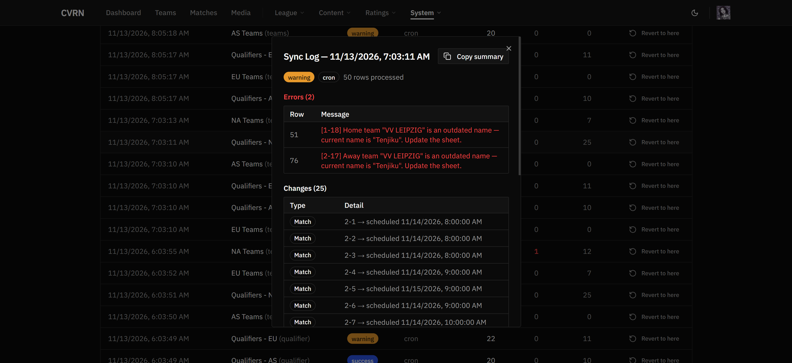
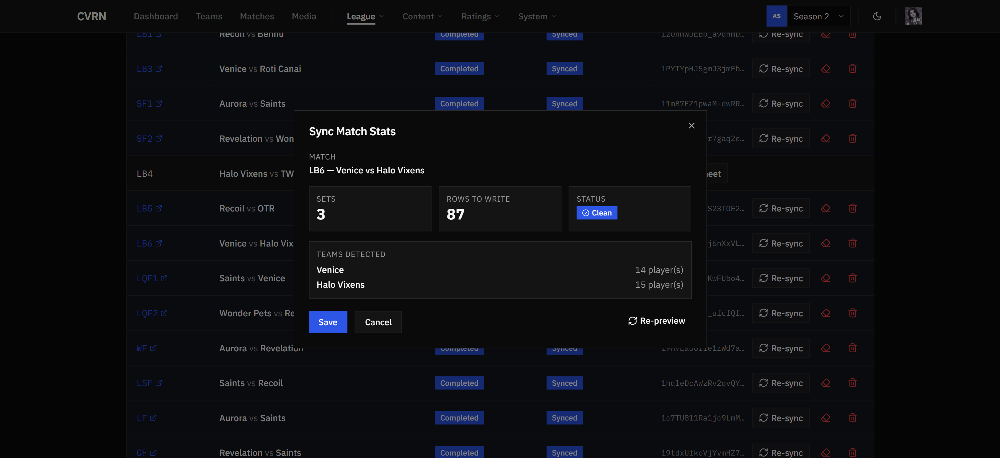

# CVRN

League management platform for CVR, a Roblox volleyball game. It tracks standings, schedules, match results, per-set player stats, playoff brackets, awards, and season history for the game's four regional leagues (AS, EU, NA, SA).

League staff keep entering data in their existing Google Sheets; CVRN syncs from them and serves everything on one site.

Live: [cvrn.net](https://cvrn.net)


## Features

### Public site

- **Standings** per region and season, ranked by the region's method (LVR, points, or points without bonus)
- **Matches** by week or playoff round, with per-set box scores, MVPs, officials, and linked GFX/VOD
- **Playoffs** bracket view (single or double elimination, upper and lower brackets)
- **Leaderboard** for every tracked stat, filterable by region, season, date range, position, and height
- **Records** for set, match, and season bests, all-time or per region/season
- **Players** search and profiles with season stats, team history, and awards
- **Teams** with rosters, team stats, match history, and name history
- **Archive** of past seasons: podium, awards, all-star teams
- **Articles** and a **media** feed (GFX, clips, team/player of the week)

| | |
|---|---|
|  |  |
|  |  |
|  |  |
|  |  |

### Admin dashboard

- Create and schedule matches, record set scores, complete, void, or correct results; playoff winners advance automatically
- Manage teams and rosters, with logo upload (resized to WebP, optional background removal)
- Add players by Roblox username; profiles and avatars are fetched from the Roblox API and refreshed in the background
- Configure Google Sheets sync per season (rosters, qualifier results, playoff results), run it manually or hourly, review per-row errors, and revert roster changes
- Import per-set player stats from a match's stat sheet with a preview before writing
- Generate playoff brackets from templates
- Set season podiums and awards
- Manage specs (stat-threshold player archetypes) and their per-region requirements
- Import game data by pasting the game's Lua config
- Write articles, media posts, and game update logs
- Invite staff by email and assign roles (`super_admin`, `admin`, `stat_tracker`, `staff`, `spec_manager`, `information_manager`)

| | |
|---|---|
|  |  |
|  |  |

### Game API

The Roblox game server reads player stats and rankings from bearer-authenticated endpoints (`ROBLOX_API_SECRET`):

| Endpoint | Returns |
|---|---|
| `GET /api/player/{robloxId}/stats?season={n\|all}` | Stat totals, per-set values, and six category percentile ranks |
| `GET /api/player/{robloxId}/details?season={n\|all}` | Player profile and season detail |
| `GET /api/stats/summary?season={n\|all}` | League-wide stat summary |
| `GET /api/archives/get?season={n}` | Champion archives for a season |

## Tech stack

| Layer | Technology |
|---|---|
| Framework | Next.js 16 (App Router, Server Components, Server Actions), React 19 |
| Language | TypeScript 5, Zod 4 |
| Database | Supabase (PostgreSQL, Row Level Security, RPC functions, views) |
| Auth and storage | Supabase Auth, Supabase Storage |
| Client data | SWR, Zustand |
| UI | Tailwind CSS, shadcn/ui (Radix UI) |
| Integrations | Google Sheets API, Roblox Users and Thumbnails APIs |
| Testing | Vitest |
| Hosting | Linode VPS, nginx, Cloudflare, GitHub Actions |

## Getting started

### Prerequisites

- Node.js 22.x
- A Supabase project and the [Supabase CLI](https://supabase.com/docs/guides/cli)
- A Google Cloud service account with read access to the league sheets (only needed for sheet sync)

### Setup

```bash
git clone <repo-url>
cd cvrn
npm install
```

Create `.env.local` in the project root:

| Variable | Required | Purpose |
|---|---|---|
| `NEXT_PUBLIC_SUPABASE_URL` | yes | Supabase project URL |
| `NEXT_PUBLIC_SUPABASE_PUBLISHABLE_KEY` | yes | Supabase publishable key |
| `SUPABASE_URL` | yes | Supabase URL for the service-role client |
| `SUPABASE_SERVICE_ROLE_KEY` | yes | Service-role key (cron jobs, invites) |
| `SITE_URL` | yes | Public base URL, e.g. `http://localhost:3000` |
| `GOOGLE_SHEETS_CREDENTIALS` | for sync | Service account JSON |
| `CRON_SECRET` | for cron | Bearer token for `/api/cron/*` |
| `ROBLOX_API_SECRET` | for game API | Bearer token for the game API |
| `STORAGE_CDN_URL` | no | Rewrites uploaded storage URLs to a CDN host |

Apply the database schema and start the dev server:

```bash
supabase link --project-ref <project-ref>
supabase db push
npm run dev
```

Open [http://localhost:3000](http://localhost:3000).

### Scripts

| Command | Description |
|---|---|
| `npm run dev` | Start the dev server |
| `npm run build` | Production build |
| `npm start` | Serve the production build |
| `npm run lint` | ESLint |
| `npm test` | Run tests once |
| `npm run test:watch` | Tests in watch mode |
| `npm run test:coverage` | Tests with coverage |

Run a single test file with `npm test -- path/to/file.test.ts`.

### Database changes

All schema changes, functions, and RLS policies live in `supabase/migrations/`. Don't edit them in the Supabase dashboard.

```bash
supabase migration new <description>
supabase db push
supabase gen types typescript --linked > database.types.ts
```

## Project structure

```
app/
  (public)/        public pages
  admin/           admin dashboard
  actions/         Server Actions, one file per domain
  api/             cron jobs, health check, cache version, game API
  hooks/           SWR data hooks
  features/        feature UI components
  components/      shared UI and layout
server/
  domains/         business logic, one folder per domain (commands/, queries/, helpers/, types/)
  db/              repositories (Supabase queries)
  cache/           cached public reads and revalidation
  roblox/          Roblox API client
  storage/         uploads and image processing
  supabase/        Supabase clients and session handling
shared/types/      types shared by client and server
supabase/
  migrations/      schema, functions, RLS policies
deploy/nginx/      nginx config
```

Requests flow `Server Action → domain command/query → repository → Supabase`. Commands and queries return `Result<T, E>` values instead of throwing. Public pages are server-rendered from tagged caches that mutations revalidate. Multi-row operations, such as completing a match and advancing the playoff bracket, run as single-transaction Postgres functions.

## Getting help

- League questions: the CVRN [Discord](https://discord.gg/bXtNACsuWF)
- Bugs or questions about the code: open an issue on this repository

## Maintainer

Built and maintained by [@tuoasty](https://github.com/tuoasty).

## License

Private project. Not licensed for redistribution.
