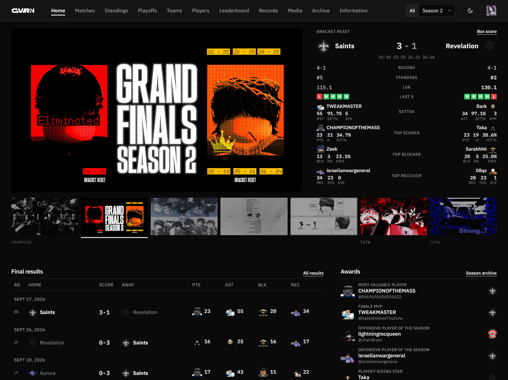
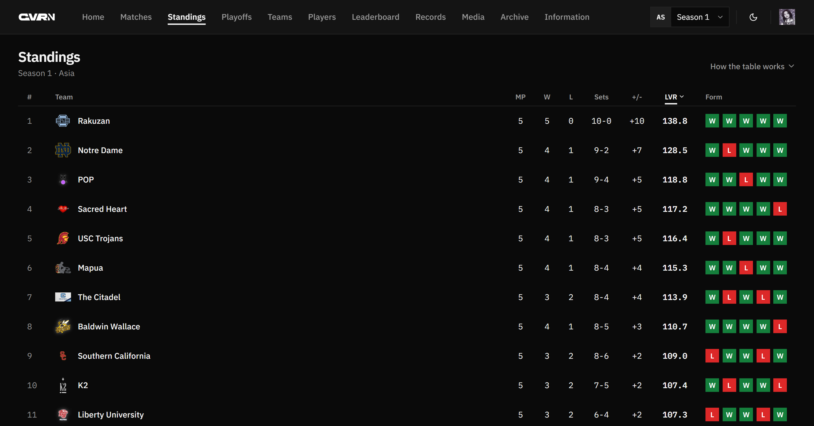
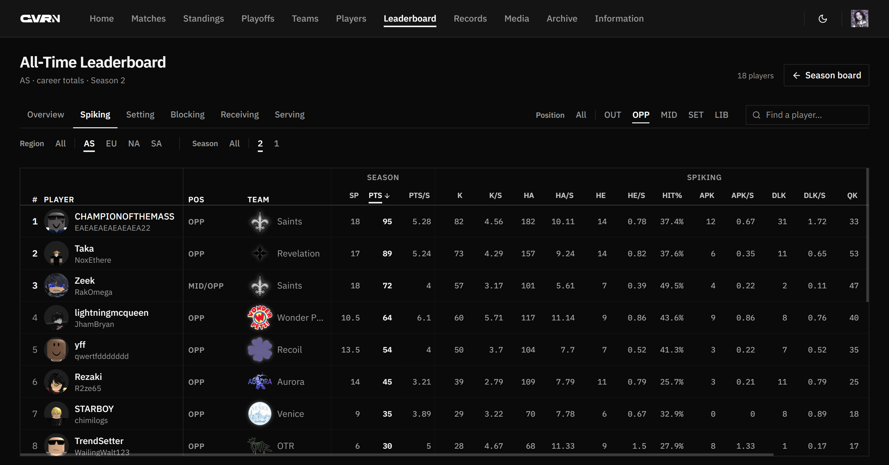
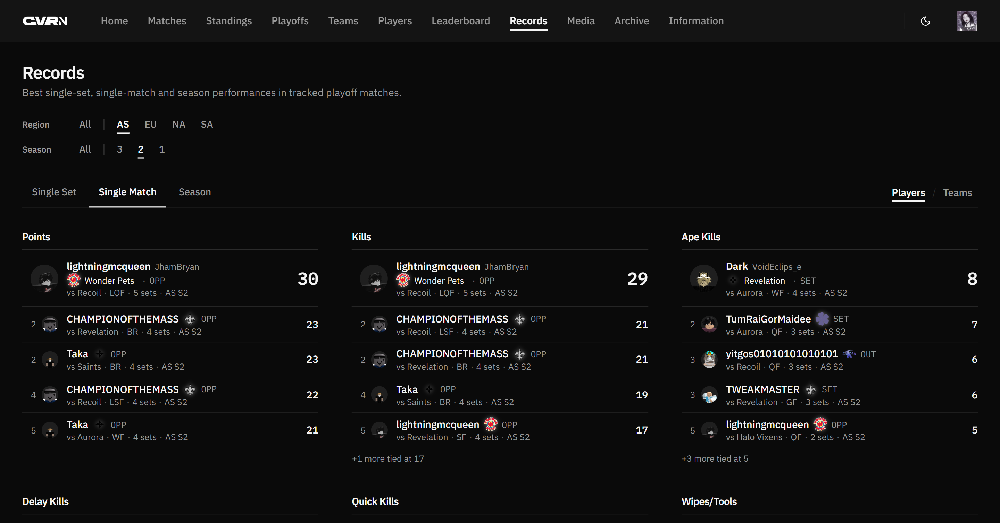
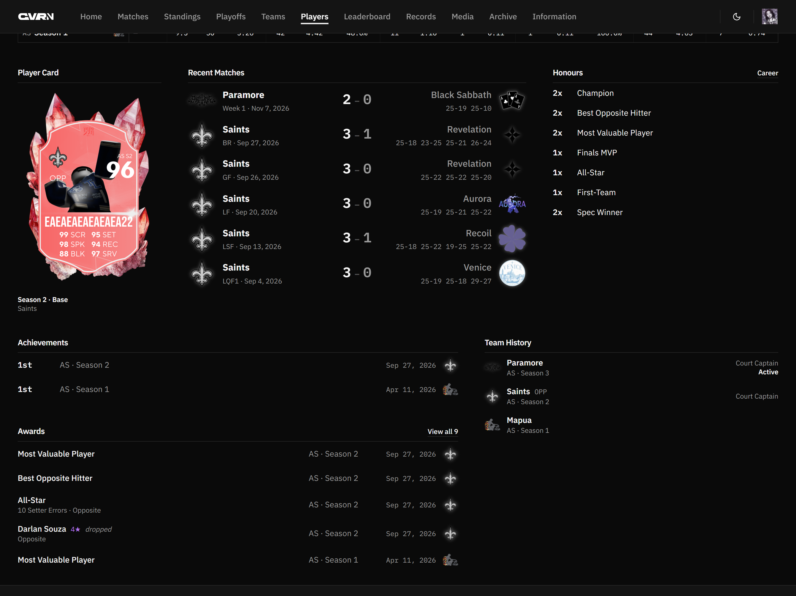
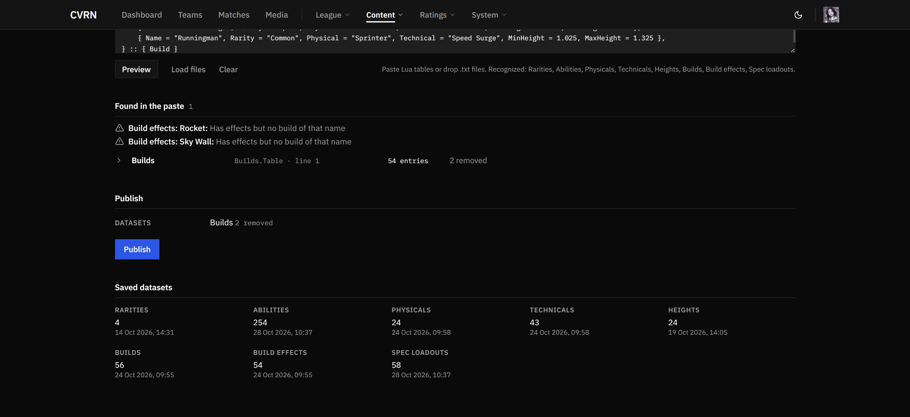
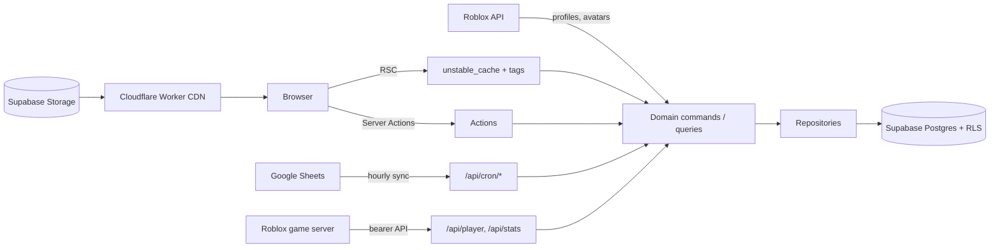

# CVRN

**The league platform for CVR, a competitive Roblox volleyball game.** Standings, schedules, box scores, playoff brackets, player stats, records, and season history for four regional leagues, kept in sync with the spreadsheets league staff already work in.

Live at **[cvrn.net](https://cvrn.net)**. Designed, built, and operated solo.



---

## The problem

Before CVRN, the league lived in scattered Google Sheets, Discord messages, and memory. Each region's staff tracked results their own way, stats sat in per-match spreadsheets nobody could search, and a season's history disappeared once the next one started.

CVRN pulls all of that into one place without asking staff to change how they work. The spreadsheets remain the input, and the site becomes the record.

---

## Engineering highlights

**Playoff brackets that can't be left half-advanced.** Completing, voiding, or correcting a playoff result has to propagate through every downstream match. That logic lives in Postgres RPCs (`complete_match`, `void_match`, `reapply_match_result`) so each cascade runs in one transaction. Voiding a match resets everything downstream with a `WITH RECURSIVE` walk, and the grand final has a guard so a bracket reset is only created when the lower-bracket side wins.

**Template-driven bracket generation.** Single and double elimination brackets, with play-ins, are expanded from a template in two in-memory passes. The generator assigns its own UUIDs, so forward pointers (winner and loser destinations) resolve before anything touches the database, and the whole bracket goes in as two batch inserts.

**Syncing from spreadsheets the app doesn't own.** League staff own the sheets and their layouts, and the playoff sheet can't be restructured, so the parser anchor-scans for match codes and reads neighbouring cells instead of trusting fixed positions. Every sync run writes an audit log with per-row errors, a partial failure doesn't abort the run, unchanged rows are skipped, and roster changes can be reverted. Per-set player stats get a full preview first and are written atomically, so a re-sync replaces a match's stats in one transaction.

**A Lua parser for game config.** The game's abilities, builds, heights, and spec loadouts live in Lua modules. Admins paste the source, and a hand-written tokenizer and parser reads the table subset the game uses. Each dataset is then normalized, diffed against what's published, and cross-checked for broken references before an atomic publish.

**Stats modelled in SQL, served back to the game.** Box scores are stored at per-set grain, and every total, efficiency, and per-set rate is derived in views, never stored. A bearer-authenticated API feeds the Roblox game server six category ranks per player. Each rank is a percentile over per-set rates shrunk toward the league mean, with attempt gates on the efficiency stats and a separate prior for primary setters. Records (set, match, and season bests for players and teams) are pre-ranked in a materialized view that refreshes concurrently when stats are published.

**Fast on a 1 GB box.** Public pages are server components that read through tagged `unstable_cache` wrappers, and each mutation revalidates only the tags it touched. Warm renders take 6 to 17 ms on the box, about 100 renders per second on one vCPU. Turning off runtime image optimization, since images are already sized at upload, cut resident memory by about 60%. Long-lived pages poll a `cache_versions` table and offer a refresh when new stats land.

**Cutting storage egress.** Supabase bills every view of a stored image as egress. A Cloudflare Worker at `cdn.cvrn.net` now fronts storage with a long edge cache and tiered caching, so repeat views cost nothing. URLs are rewritten at upload time behind an env-var kill switch, and versioned query strings bust the cache on re-upload.

**Moving off serverless.** The app moved from Vercel to a Linode VPS behind Cloudflare: CI builds a standalone artifact, deploys are gated on a health check plus real route checks, origin pulls are authenticated so only Cloudflare can reach the box, and cron jobs became systemd timers. Bad config at boot exits with code 78 so systemd stops instead of crash-looping.

**Security at the database.** Row-level security is the enforcement boundary, not application code. Public reads go to `anon`, writes check `user_roles` across seven roles, stat trackers can write only stat tables, and batch-destructive actions require `super_admin` both at the action layer and in the UI. Spec thresholds have no public read; the public page renders from an admin-published snapshot that masks them as difficulty tiers.

---

## Features

### Public

| | |
|---|---|
|  |  |
| **Standings.** Per region and season, computed from match results using each region's ranking method (LVR, points, or points without bonus). | **Matches.** Weekly schedule and playoff rounds with shareable URLs; each match has a per-set box score, MVPs, officials, and linked GFX or VOD. |
|  |  |
| **Playoffs.** Upper and lower bracket display with seeds and live advancement. | **Leaderboard.** Every tracked stat, filterable by region, season, date range, position, and height. |
|  |  |
| **Records.** Set, match, and season bests for players and teams, scoped all-time, by region, or by season. | **Players.** Search across every player ever rostered; profiles show season stats, team history, awards, and specs earned. |
|  |  |
| **Teams.** Rosters with roles and positions, team stats, match history, and name changes. | **Archive.** Every past season's podium, champion GFX, individual awards, and all-star teams. |

Also: articles with inline image placement, and a media feed (GFX, clips, team and player of the week).

### Admin

| | |
|---|---|
|  |  |
| **Match lifecycle.** Schedule, record set scores, complete, void, or correct; assign referees and media officials. | **Sheets sync.** Per-season sheet configs, hourly auto-sync, per-run logs with row-level errors, and revert. |
|  |  |
| **Stats import.** Link a match to its stat sheet, preview every parsed row, then write and publish. | **Game data.** Paste Lua from the game, review the diff, publish. |

Also: team and roster management with logo processing (resize plus optional background removal), Roblox player lookup with background profile refresh, season podiums and awards with avatar snapshots, spec catalog and per-region requirements, media and article editors, game update logs, cache controls, and email invites with role assignment.

---

## Architecture



**Vertical slices with command/query separation.** Eighteen domains under `server/domains/` (match, playoff, sheets, matchStats, spec, gameData, record, and more) each own their `commands/`, `queries/`, `helpers/`, and `types/`. There's no shared service layer. Server Actions validate input with Zod and call a command or query directly, and repositories in `server/db/` are plain Supabase queries.

**Errors are values.** Every command, query, and action returns `Result<T, E>`. A closed `ErrorCode` union crosses the wire, and the client maps it to user-facing copy, so nothing throws across a boundary.

**Logic sits where it's safest.** Multi-row invariants such as bracket cascades, atomic stat replacement, and requirement replacement are Postgres functions. Ranking and derived stats are views. TypeScript handles orchestration, parsing, and integrations.

---

## Stack

| Layer | Technology |
|---|---|
| Framework | Next.js 16 (App Router, Server Components, Server Actions), React 19 |
| Language | TypeScript 5, Zod 4 |
| Database | Supabase Postgres: RLS, RPCs, views, materialized views, `pg_trgm` |
| Auth & storage | Supabase Auth (email invites, role-based routing), Supabase Storage behind a Cloudflare Worker |
| Client data | SWR, Zustand |
| UI | Tailwind CSS, shadcn/ui (Radix), IBM Plex Sans / Mono |
| Integrations | Google Sheets API, Roblox Users and Thumbnails APIs |
| Testing | Vitest (97 test files) |
| Infra | Linode VPS, nginx, systemd timers, Cloudflare (DNS, caching, authenticated origin pulls), GitHub Actions |

---

## Running locally

```bash
npm install
npm run dev
```

Requires `.env.local`:

| Variable | Purpose |
|---|---|
| `NEXT_PUBLIC_SUPABASE_URL`, `NEXT_PUBLIC_SUPABASE_PUBLISHABLE_KEY` | Supabase project |
| `SUPABASE_URL`, `SUPABASE_SERVICE_ROLE_KEY` | Service-role client (cron, invites) |
| `GOOGLE_SHEETS_CREDENTIALS` | Sheets service account JSON |
| `CRON_SECRET` | Bearer for `/api/cron/*` |
| `ROBLOX_API_SECRET` | Bearer for the game API |
| `SITE_URL` | Absolute URLs, invite redirects, sitemap |
| `STORAGE_CDN_URL` | Optional; rewrites storage URLs to the CDN at upload |

```bash
npm run build           # production build
npm run lint
npm test                # Vitest once
npm run test:coverage

supabase db push                                            # apply migrations
supabase gen types typescript --linked > database.types.ts  # regenerate types
```

Schema changes go through `supabase/migrations/` (139 migrations); nothing is edited in the dashboard.

---

## Project structure

```
app/
  (public)/        standings, matches, teams, playoffs, leaderboard, records, players, archive, articles, media
  admin/           match, team, season, playoff, sync, stats, specs, game-data, media, articles, cache, invite
  actions/         Server Actions, one file per domain
  api/             cron jobs, health, cache version, game API
  hooks/           SWR hooks
  features/        feature UI (dialogs, forms, tables)
server/
  domains/         18 vertical slices: commands/ queries/ helpers/ types/
  db/              repositories (Supabase queries returning Result)
  cache/           tagged unstable_cache reads, revalidation, cache versions
  roblox/          Roblox client with retry and circuit breaker
  storage/         uploads, image processing, CDN URL rewrite
  supabase/        server, public, browser, admin clients, middleware
shared/types/      types shared by client and server
supabase/migrations/
deploy/nginx/      nginx config
```

---

## License

Private project. Not licensed for redistribution.
